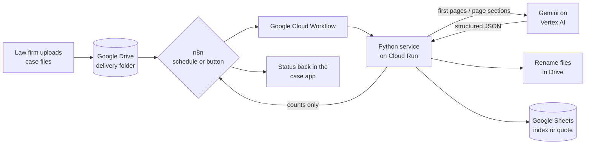

# Medical Records Automation: Records Helper + Case Quote

Two production automations built for a medical-legal consulting practice, published here in sanitized form.
Both take the case files that law firms send (often hundreds of pages of medical records and bills, in
whatever state they arrive) and turn them into clean, organised, checkable data in Google Drive and Google Sheets.

| Tool | What it does |
|---|---|
| [**Records Helper**](records-helper/) | Every morning, finds newly delivered case files, gives each PDF a clear numbered name based on who it is from, and keeps an index spreadsheet of everything received. |
| [**Case Quote**](case-quote/) | Before a case is accepted, reads every page of the files sent and counts providers, record pages and billing lines into a quote spreadsheet, so the job can be priced. |

## The problem

Case files arrive from many senders with names like `SCAN_00417.pdf` or `fax_0093.pdf`. Before any real
work could start, someone had to open each file, work out which clinic or hospital it came from, rename
it, number it, and log it in a spreadsheet. Pricing a new case meant paging through every document to count
providers, pages and charges by hand. That work was slow, repetitive and easy to get wrong: a missed file,
a number used twice, or the same provider counted under two spellings. These tools do that work
automatically and flag anything they are unsure about for a person to check, instead of guessing.

## How it works



1. **n8n** decides what needs doing (a daily schedule for the Records Helper, a button press for Case Quote)
   and starts a run on Google Cloud.
2. A **Python service** lists the files and applies the rules in this repo: numbering, dates, which
   files to skip, how to match provider spellings.
3. Only when the file name is not enough does it ask **Gemini** to read the pages. The AI answers in a
   fixed JSON shape, and every answer is checked before it is used.
4. Results land in **Google Sheets** (and file names in **Google Drive**). n8n only ever receives counts
   and status codes, never file names or record contents, so patient data stays inside Google Cloud.

## Design choices worth noting

- **Never overwrite a person's work.** Rows are matched by Drive file ID, so re-runs add nothing twice, and a
  file someone renamed by hand is never renamed back.
- **Unsure means "needs a look", not a guess.** Locked PDFs, unclear AI answers and repeated numbers are
  flagged in the sheet for a person.
- **Cheap first, AI second.** A file whose name already clearly names a known provider is handled without
  any AI call.
- **Every page is accounted for.** In Case Quote, pages that belong to no provider (letters, blank pages,
  pages the AI skipped) go to their own "Other pages" rows, so the totals always add up.
- **Tested rules.** All decision logic is pure Python with automated tests.

## Tools used

n8n · Python (Flask, pypdf) · Google Gemini on Vertex AI · Google Cloud Run · Google Cloud Workflows ·
Google Drive API · Google Sheets API · Softr (case app front end)

## Repository layout

```
records-helper/
  src/            logic.py (rules), reader.py (Gemini step), demo.py, test_logic.py
  n8n/            n8n workflow export + Google Cloud Workflow step
  sample-data/    fake input and the output the demo produced from it
case-quote/
  src/            quote.py + names.py (rules), reader.py (Gemini step), demo.py, test_quote.py
  n8n/            n8n workflow export
  sample-data/    fake input and the output the demo produced from it
```

## Try it locally (no Google account needed)

Requires Python 3.10+.

```bash
python3 -m venv .venv
source .venv/bin/activate
pip install -r requirements.txt

# Records Helper: tests, then the demo on fake files
cd records-helper && python -m pytest src && python src/demo.py && cd ..

# Case Quote: tests, then the demo on fake page answers
cd case-quote/src && python -m pytest && python demo.py ../sample-data/input/case-files.json ../sample-data/output && cd ../..
```

The demos use saved, made-up AI answers instead of calling Gemini, so they run offline and give the same
result every time. The files in each `sample-data/output` folder were produced by exactly these commands.

## Running it for real

1. Copy `.env.example` to `.env` and fill in your own values.
2. Import the JSON files in each `n8n/` folder into n8n (**Workflows → Import from file**), then
   reconnect every credential marked `REPLACE_ME` and replace every `YOUR_...` placeholder.
3. Deploy a small Flask service on Google Cloud Run that lists Drive files, calls the functions in
   `logic.py` and `reader.py`, and writes the results to Sheets. That wrapper (Drive/Sheets API calls,
   authentication, retries) is part of the production system but is **not included here**, because it
   was tied to the client's own folder structure.

## Sanitized for confidentiality

This code comes from a real client project. Before publishing:

- All client, staff, patient and case names, firms, email addresses and domains were removed.
- All Google Drive, Sheets, Softr, n8n credential and Google Cloud project IDs, service URLs and
  webhook paths were replaced with `YOUR_...` / `REPLACE_ME` placeholders.
- Everything in `sample-data/` is invented. Any resemblance to a real provider or person is accidental.
- Client-specific features (a vendor-specific order-email parser, one-off migration code, internal
  notes) were removed. The rules that remain are the production rules, lightly renamed.
- The tests were rewritten using only fake data.

## License

[MIT](LICENSE)
