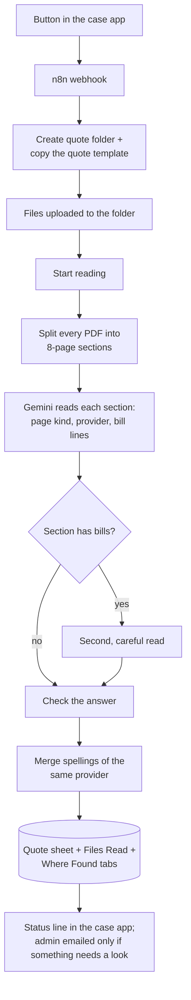

# Case Quote

Reads every page of a prospective case's files and fills a quote spreadsheet with the three numbers the
job is priced from: **providers, record pages and billing lines**. See the [main README](../README.md)
for the full picture, setup and the confidentiality note.

## What one run does

## Example (from `sample-data/`, all fake)

Two PDFs with 11 pages, plus a zip and a photo:

| Medical Provider | Record Pages | Billing Lines |
|---|---|---|
| Riverbend Physical Therapy | 4 | 2 |
| Lakeside Orthopedics | 3 | 3 |
| Example Health System | 1 | 0 |
| Other pages – legal & admin papers | 1 | 0 |
| Other pages – blank | 1 | 0 |
| Other pages – skipped by the AI | 1 | 0 |

What this shows:
- `Lakeside Orthopedics`, `LAKESIDE ORTHOPEDICS, INC.` and `Lakeside Ortho` became **one** provider.
- A chiropractor first seen without a practice name joined **Riverbend Physical Therapy** once a later
  page tied them together.
- Clinics of a large health system are counted as one row (configurable in `names.py`).
- A page the AI left out of its answer is still counted, on its own row, so totals always add up.
- The zip file is listed with "unzip it to include it", so nothing is silently skipped.

Full output: [`quote-table.csv`](sample-data/output/quote-table.csv) ·
[`files-read.csv`](sample-data/output/files-read.csv) ·
[`where-found.csv`](sample-data/output/where-found.csv)

## Files

| File | Purpose |
|---|---|
| `src/quote.py` | Grouping pages into providers, Other pages reasons, and the Google Sheets row/formula writes |
| `src/names.py` | Provider-name matching rules (abbreviations, suffixes, cut-off spellings, doctor names) |
| `src/reader.py` | The Gemini instruction, the JSON answer shape, and the answer checker |
| `src/demo.py` | Runs the rules on `sample-data/input/case-files.json` |
| `src/test_quote.py` | Automated tests |
| `n8n/case-quote.workflow.json` | The n8n workflow: webhook, folder + template copy, start the Google run, poll, write the status, alert on problems |
