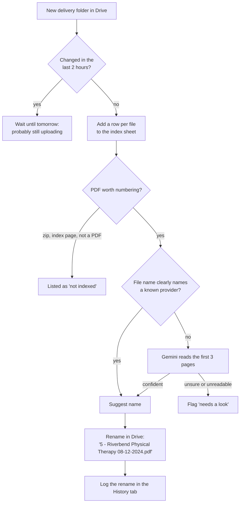

# Records Helper

Renames and indexes incoming case records every morning. See the [main README](../README.md) for the
full picture, setup and the confidentiality note.

## What one run does

## Example (from `sample-data/`, all fake)

| Arrived as | Renamed to | Why |
|---|---|---|
| `Lakeside Orthopedics records 01-15-2024 to 06-30-2024.pdf` | `3 - Lakeside Orthopedics 01-15-2024 to 06-30-2024.pdf` | Name matched a known provider, no AI needed; date range kept |
| `SCAN_00417.pdf` | `4 - Northgate Imaging Center.pdf` | AI read the first pages |
| `Riverbend PT Bills.pdf` | `5 - Riverbend Physical Therapy.pdf` | Abbreviation not enough to be sure, so the AI read it |
| `Plaintiff Interrogatory Responses.pdf` | *(not renamed)* | Legal paper, not a medical record |
| `fax_0093.pdf` | *(not renamed)* | AI was unsure, so flagged "needs a look" |

Numbering continues from the case's existing files (here 1 and 2), so numbers never repeat.

Full output: [`index-sheet.csv`](sample-data/output/index-sheet.csv) ·
[`rename-history.csv`](sample-data/output/rename-history.csv) ·
[`run-summary.json`](sample-data/output/run-summary.json)

## Files

| File | Purpose |
|---|---|
| `src/logic.py` | All the rules: numbering, dates, skip reasons, provider matching, sheet updates |
| `src/reader.py` | The Gemini instruction, the JSON answer shape and the first-pages extractor |
| `src/demo.py` | Runs the rules end to end on `sample-data/input/delivery.json` |
| `src/test_logic.py` | Automated tests |
| `n8n/index-delivery-files.workflow.json` | The n8n workflow: daily schedule, find open deliveries, start the Google run, wait, write statuses back |
| `n8n/google-cloud-workflow.yaml` | The Google Cloud Workflows step between n8n and the Python service |
